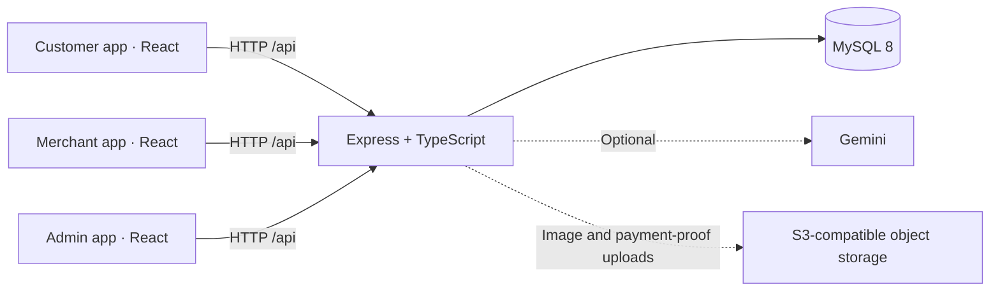

# TanTan · Island Street Food

[简体中文](README.md) | **English**

**A food ordering and merchant management platform for island street-food stalls.**

TanTan (滩摊) is a Vibe Coding portfolio project built around three roles: customers, stall owners, and platform administrators. It connects menu browsing, product customization, orders split by merchant, manual payment confirmation, and pickup verification through a shared API and database.

The project demonstrates AI-assisted development through working frontend and backend code, a complete local demo flow, interface screenshots, and reproducible setup instructions. Its visual design draws on island markets, beach food trucks, mint greens, coconut yellows, and palm illustrations.

[Quick start](#quick-start) · [Demo walkthrough](docs/demo.en.md) · [Architecture](docs/architecture.en.md) · [Validation](docs/validation.en.md) · [Third-party assets](docs/third-party-assets.en.md)

## Screenshots

These are screenshots of the running application with fictional local demo data. The current application interface is in Chinese; this English edition covers the project documentation.

<table>
  <tr>
    <td width="28%" valign="top"><strong>Customer ordering</strong><br></td>
    <td width="72%" valign="top"><strong>Merchant dashboard</strong><br><br><strong>Platform administration</strong><br></td>
  </tr>
</table>

## What the project includes

| Application | Main features | Documentation |
| --- | --- | --- |
| Customer app | Enter a stall code, browse menus, select options, manage a cart across merchants, place orders, track status, view pickup codes, and save favorites | [`c-app`](c-app/README.en.md) |
| Merchant app | Manage products and options, mark items sold out, configure stock limits, confirm payments, prepare and complete orders, view statistics, and update store details | [`b-app`](b-app/README.en.md) |
| Admin app | Create and manage merchants, view platform statistics, generate stall QR codes, and configure feature flags and help content | [`admin-app`](admin-app/README.en.md) |
| API | Validate access, serve product and order endpoints, calculate prices, persist data in MySQL, and integrate optional AI and image storage services | [`api`](api/README.en.md) |

Implementation highlights:

- **One order flow across three roles.** Customer ordering, merchant fulfillment, and administrative views use the same API and database.
- **Interactions designed around physical stalls.** Stall codes and entry QR codes connect the app to a stall; pickup codes support order verification at collection.
- **Configurable menus and server-side pricing.** Products support options, price adjustments, and sold-out flags. Cart entries distinguish option selections, while the server calculates prices from catalog data and splits orders by merchant.
- **Interfaces tailored to each role.** The customer app emphasizes mobile browsing, while the merchant and admin apps provide operational workspaces.
- **Optional AI features.** The backend includes Gemini recommendation endpoints using product and merchant context. The customer homepage can request a short island-themed message; basic ordering does not require an AI key.

## Architecture



The frontend uses **React 19, TypeScript, Vite, Tailwind styles, and Lucide icons**. The backend uses **Node.js, Express, and mysql2**. Four npm workspaces share a root installation and development command.

## Quick start

Prerequisites: **Node.js 22.12 or later** and **Docker Compose**, or an existing **MySQL 8** instance.

Clone the repository and install dependencies:

```bash
git clone https://github.com/HuangWwenGang/tantan.git
cd tantan
npm install
```

Create the local API configuration using the command for your operating system:

```powershell
# Windows PowerShell
Copy-Item api/.env.example api/.env.local
```

```bash
# macOS / Linux
cp api/.env.example api/.env.local
```

Start the demo database. Once its status is `healthy`, start all four services:

```bash
docker compose up -d
docker compose ps
npm run dev
```

The API creates the database tables on startup. With `DEMO_SEED=true`, it populates empty tables with fictional demo merchants and products. Demo seeding is disabled by default in production. If you use an existing MySQL instance, update the `MYSQL_*` settings in `api/.env.local` first.

| Service | Local address |
| --- | --- |
| Customer app | http://localhost:3000 |
| Merchant app | http://localhost:3001 |
| Admin app | http://localhost:3002 |
| API health check | http://localhost:8787/api/health |

**Local demo accounts:**

| Role | Login identifier | Demo password |
| --- | --- | --- |
| Administrator | `admin` | `local-demo-admin-password` |
| Merchant | `HI888`, `COOL99`, or `SEA666` | `demo-merchant-123` |
| Customer | No login required; enter one of the stall codes on the homepage | — |

The initial administrator account comes from `ADMIN_USERNAME` and `ADMIN_PASSWORD` in `api/.env.local`; the table above matches the local defaults in `.env.example`. Demo merchants are defined in `api/data.ts`. These credentials are public and intended only for local demonstrations. Editing the example configuration does not reset accounts in an existing database.

Browsing and ordering do not require Gemini or object storage. To upload product images, store images, payment QR codes, or payment proofs, configure `RAINYUN_*` for an S3-compatible storage service. Set `GEMINI_API_KEY` to enable the AI endpoints.

Run the checks and build:

```bash
npm run typecheck
npm test
npm run build
```

You can also start an individual workspace, such as `npm run dev -w c-app`. During development, all three frontends proxy `/api` to port `8787`; the API and MySQL must be running for data-backed features to work.

## Current scope

The main demo flow is **pickup / dine-in ordering → manual payment confirmation → order preparation → pickup verification**.

| Area | Current implementation |
| --- | --- |
| Payments | Merchant payment QR codes, a customer “I have paid” action, and manual merchant confirmation. No WeChat Pay / Alipay payment SDK integration, verified payment callbacks, or refunds through a payment provider. |
| Beach delivery | UI elements and some data structures exist, but customer delivery checkout is disabled. There is no courier dispatch or live delivery system. |
| Customer identity | A browser-generated anonymous `X-Buyer-Id` associates orders with that browser. There is no SMS verification, verified customer account, or account sync across devices. |
| Favorites and visit history | Stored in the current browser's localStorage. |
| Reviews, coupons, addresses, and feedback | Presentation or prototype interactions; these do not yet form complete backend workflows. Displayed coupons should not be treated as real redemption. |
| AI | The homepage message calls the API. Recommendation endpoints and an advisor component exist, but the advisor is not connected to the main navigation. Without a key, the AI endpoints return empty content. |
| Data updates | HTTP requests and periodic refreshes; no WebSocket push updates. |

This is a development and portfolio version. Merchant and admin access have basic checks; customer authentication, concurrent stock handling, order state constraints, auditing, and production deployment require further work. See [security and demo boundaries](SECURITY.en.md) for details.

## Repository guide

```text
tantan/
├── c-app/                # Customer app
├── b-app/                # Merchant app
├── admin-app/            # Platform administration
├── api/
│   ├── server/index.ts   # HTTP routes, access checks, and input validation
│   ├── server/db.ts      # Schema initialization and business data operations
│   ├── server/ai-service.ts
│   └── server/oss.ts
├── docs/                 # Architecture, demo, validation, and asset notes
├── tests/                # Business-rule tests
├── compose.yaml          # Local MySQL service
└── package.json          # Workspaces and shared commands
```

Continue with the [demo walkthrough](docs/demo.en.md), [architecture and key implementation details](docs/architecture.en.md), [validation record](docs/validation.en.md), and [third-party assets and services](docs/third-party-assets.en.md).
