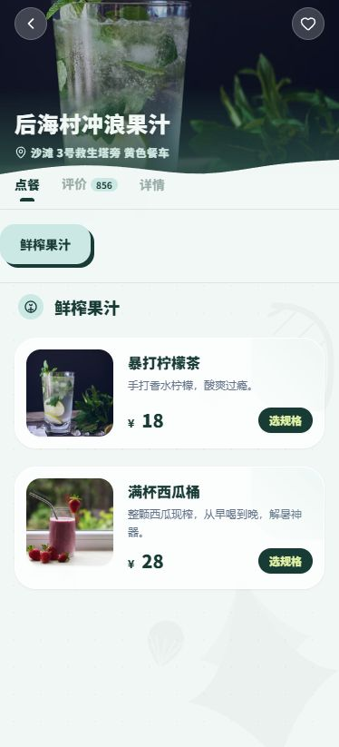
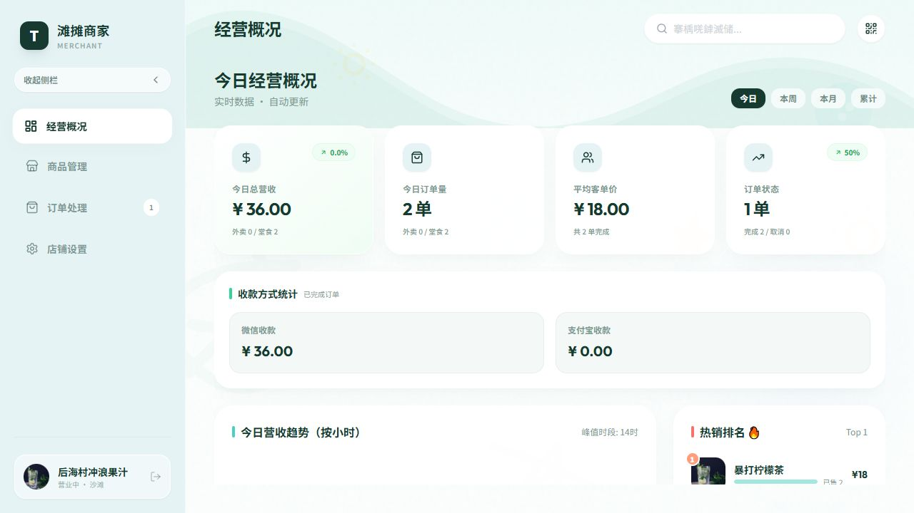
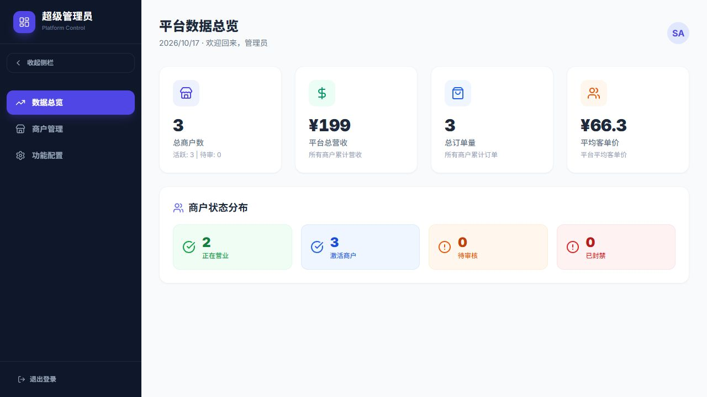
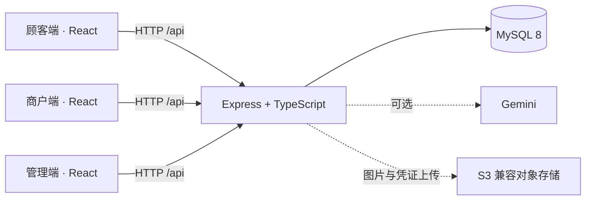

# 滩摊 TanTan

**简体中文** | [English](README.en.md)

**把海岛地摊的点餐、出餐和经营管理，放进一套有海风感的多端应用。**

滩摊是一个以海岛夜市、沙滩餐车和小摊位为场景的 Vibe Coding 项目。项目围绕顾客、摊主和平台管理员三个角色，连接商品选择、规格加价、按店拆单、人工确认收款和取餐核销，保留了薄荷绿、椰子黄、圆角卡片与椰树插画组成的海岛视觉。

这是用于展示 AI 协作开发能力的项目作品，包含前后端实现、业务流程、真实界面截图和可复现的本地启动方式。

[快速启动](#快速启动) · [演示动线](docs/demo.md) · [架构与实现](docs/architecture.md) · [第三方素材](docs/third-party-assets.md)

## 界面预览

以下为本地运行截图，使用虚构演示数据。

<table>
  <tr>
    <td width="28%" valign="top"><strong>顾客点餐</strong><br></td>
    <td width="72%" valign="top"><strong>商户经营工作台</strong><br><br><strong>平台管理</strong><br></td>
  </tr>
</table>

## 可以看什么

| 端 | 主要体验 | 对应目录 |
| --- | --- | --- |
| 顾客端 | 输入摊位码进店、菜单与规格选择、多店购物车、下单、订单进度、取餐码、收藏 | [`c-app`](c-app) |
| 商户端 | 商品与规格管理、售罄与库存设置、收款确认、制作与核销、经营统计、店铺装修 | [`b-app`](b-app) |
| 管理端 | 商户开通与状态管理、平台统计、摊位二维码、功能开关与客服内容配置 | [`admin-app`](admin-app) |
| API | 身份校验、商品与订单接口、服务端计价、MySQL 持久化、可选 AI 与图片存储 | [`api`](api) |

项目里值得关注的实现：

- **同一笔点餐，跨三个角色协作。** 顾客下单、商户处理、管理端查看数据，使用同一套 API 和数据库。
- **围绕摊位设计交互。** 摊位码和进店二维码连接线下摊位；自提订单用取餐码与核销流程完成交付。
- **菜单不只是商品列表。** 商品支持多规格、加价项、售罄标记；购物车按商品和规格区分，服务端根据商品数据计算金额，并按商户拆单。
- **视觉与经营场景保持一致。** 顾客端偏移动端浏览，商户端与管理端偏工作台操作，共用海岛风格。
- **AI 是可选增强。** 后端预留基于商品、摊位信息的 Gemini 推荐接口，首页可获取简短海岛提示；基础点餐流程无需 AI 密钥。

## 架构



前端使用 **React 19、TypeScript、Vite、Tailwind 样式和 Lucide 图标**；后端使用 **Node.js、Express、mysql2**。仓库通过 npm workspaces 管理四个应用。

## 快速启动

需要 **Node.js 22.12 或更高版本**，以及 **Docker Compose**；也可使用已有的 MySQL 8 实例。

在仓库根目录安装依赖，并创建本地配置：

```bash
npm install
```

```powershell
# Windows PowerShell
Copy-Item api/.env.example api/.env.local
```

```bash
# macOS / Linux
cp api/.env.example api/.env.local
```

启动演示数据库，确认状态为 `healthy` 后启动四个服务：

```bash
docker compose up -d
docker compose ps
npm run dev
```

API 首次连接数据库时会创建表；`DEMO_SEED=true` 时在空表中写入虚构演示摊位和商品。生产环境默认不写入演示种子。若使用自己的 MySQL，请先调整 `api/.env.local` 的 `MYSQL_*` 配置。

| 服务 | 本地地址 |
| --- | --- |
| 顾客端 | http://localhost:3000 |
| 商户端 | http://localhost:3001 |
| 管理端 | http://localhost:3002 |
| API 健康检查 | http://localhost:8787/api/health |

**本地演示登录：**

| 角色 | 登录标识 | 演示密码 |
| --- | --- | --- |
| 管理员 | `admin` | `local-demo-admin-password` |
| 商户 | `HI888`、`COOL99` 或 `SEA666` | `demo-merchant-123` |
| 顾客 | 无需登录；首页输入上述任一摊位码 | — |

管理员初始账号来自 `api/.env.local` 中的 `ADMIN_USERNAME` 和 `ADMIN_PASSWORD`；上表对应 `.env.example` 的默认本地配置。演示商户来自 `api/data.ts`。这些是公开的本地演示凭据，请勿用于公开部署。已有数据库不会因编辑示例配置自动重置账号。

基础浏览和下单不需要 Gemini 或对象存储配置。要演示上传商品图片、店铺图片、收款码或支付凭证，需要填写 `RAINYUN_*` 对象存储配置；要启用 AI 接口，需要填写 `GEMINI_API_KEY`。

构建与类型检查：

```bash
npm run typecheck
npm test
npm run build
```

也可以单独启动一个工作区，例如 `npm run dev -w c-app`。三个前端在开发模式下把 `/api` 代理到 `8787` 端口；单独启动前端时仍需运行 API 和 MySQL。

## 功能边界

这个版本的主要演示路径是 **自提 / 堂食点餐 → 人工确认收款 → 制作完成 → 取餐核销**。

| 模块 | 当前实现 |
| --- | --- |
| 支付 | 展示商户收款码、顾客标记「我已支付」、商户人工确认；没有接入微信 / 支付宝支付 SDK、支付回调验签或真实资金退款 |
| 海滩配送 | 保留界面与部分数据结构，顾客结算入口暂未开放；没有骑手调度或实时配送系统 |
| 顾客身份 | 浏览器生成匿名 `X-Buyer-Id`，用于关联订单；没有短信验证、正式消费者账号或跨设备账号同步 |
| 收藏与访问记录 | 保存在当前浏览器的 localStorage |
| 评价、优惠券、地址与反馈 | 包含展示或原型交互，尚未形成完整的服务端业务闭环；演示下单请勿把优惠券展示当作真实核销 |
| AI | 首页海岛提示已接入 API；推荐接口和顾问组件保留在代码中，顾问尚未接入主导航；未配置密钥时接口返回空内容 |
| 数据更新 | 通过 HTTP 请求与定时刷新同步，没有 WebSocket 推送 |

这是开发与作品展示版本。登录与商户数据访问有基础校验，但匿名顾客标识、库存并发控制、订单状态约束、审计及生产部署仍需要继续完善。

## 仓库导览

```text
tantan/
├── c-app/                # 顾客端
├── b-app/                # 商户端
├── admin-app/            # 平台管理端
├── api/
│   ├── server/index.ts   # HTTP 路由、鉴权与输入校验
│   ├── server/db.ts      # 数据表初始化与业务读写
│   ├── server/ai-service.ts
│   └── server/oss.ts
├── docs/                 # 架构、演示与素材说明
├── compose.yaml          # 本地 MySQL
└── package.json          # 工作区与统一命令
```

继续了解：[三端演示步骤](docs/demo.md)、[数据流与关键代码](docs/architecture.md)、[第三方素材和外部服务](docs/third-party-assets.md)。
