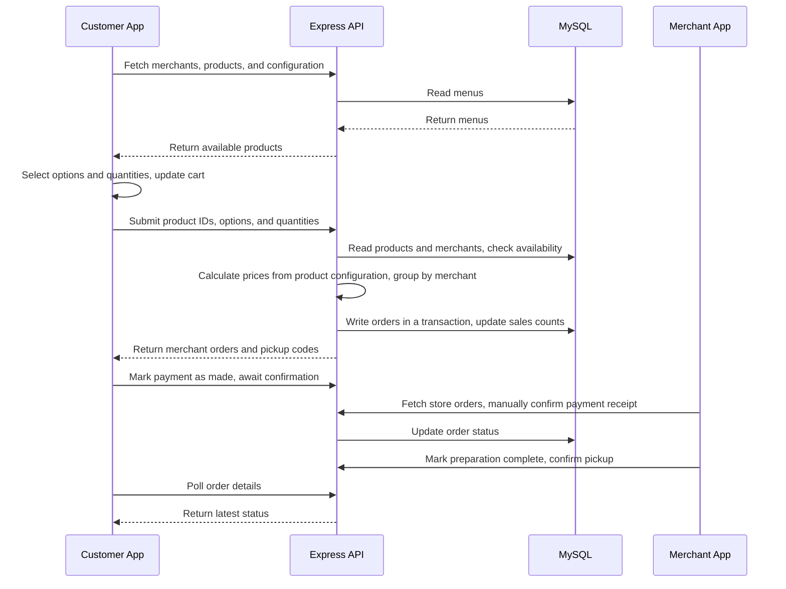
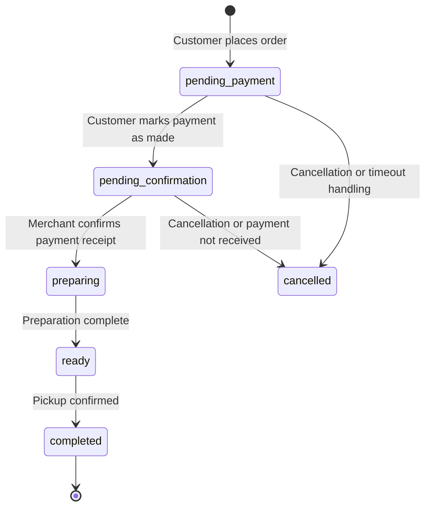

# Architecture and Implementation

[简体中文](architecture.md) | **English**

TanTan consists of three separate React applications and a shared API. Each frontend handles interactions for its user role, the API handles data access and business calculations, and MySQL stores merchants, products, orders, and platform settings.

## Application Boundaries

| Directory | Responsibilities | Entry points and key files |
| --- | --- | --- |
| `c-app` | Customer browsing, menu selection, cart, checkout, and orders | `App.tsx`, `components/CheckoutView.tsx`, `components/OrderDetailView.tsx` |
| `b-app` | Merchant login, product maintenance, order processing, and store settings | `App.tsx`, `components/OrderManager.tsx`, `components/ProductManager.tsx` |
| `admin-app` | Merchant management, business overview, and platform configuration | `src/App.tsx`, `src/components/VendorManager.tsx`, `src/components/ConfigPanel.tsx` |
| `api` | HTTP endpoints, access controls, pricing, and persistence | `server/index.ts`, `server/db.ts`, `utils/specs.ts` |

During development, Vite proxies each frontend's `/api` requests to `localhost:8787`. Deployment requires separate configuration for access to the frontend assets and API; the Vite development proxy is not a production gateway.

## Order Data Flow

The frontend submits the customer's selections. Base prices come from the database, and option surcharges are calculated from product configuration. One cart submission can produce multiple merchant orders. Order items store snapshots of names, amounts, images, and other details at the time of purchase.

Basic stock and sales-count checks and updates are implemented. These stock checks do not constitute a complete solution for preventing overselling under high concurrency.

## Order States

The diagram below shows the main path used in the current pickup demo. It does not imply that every server-side state transition is strictly enforced:

The corresponding code values are `pending-payment`, `pending-confirmation`, `preparing`, `ready`, `completed`, and `cancelled`. The model also retains `delivering`, but the customer app does not currently support placing beach-delivery orders.

Payment status and order status are recorded separately. WeChat Pay and Alipay in the interface refer to merchants' offline payment methods. The API's `payment-callback` endpoint is an administrator-protected status update endpoint; it is not an integrated payment-provider callback with signature verification.

## Data and Identity

| Table | Stored data |
| --- | --- |
| `vendors` | Stall codes, store profiles, opening settings, login password hashes, and related data |
| `products` | Products, categories, option configurations, prices, sold-out flags, and sales counts |
| `orders` | Order snapshots, customer identifiers, pickup codes, statuses, payment evidence, and related data |
| `admins` | Administrator accounts and password hashes |
| `settings` | Platform configuration, default addresses, delivery-interest counts, and related data |

On startup, the API creates the database and tables. When `DEMO_SEED` is enabled, it populates empty business-data tables with fictional demo data defined in `api/data.ts`. Demo seeding is enabled by default in development and disabled by default in production. Initialization does not require a database dump.

- Administrators and merchants receive signed tokens with expiry times from the login endpoints. The server filters and validates merchant requests against the merchant associated with the token.
- Passwords are stored as scrypt hashes. Login tokens are stored in the browser. See the root README's [Quick Start](../README.en.md#quick-start) for local demo accounts.
- The customer app generates and stores an anonymous identifier in localStorage and associates orders through `X-Buyer-Id`. This is not a verified customer account. Clearing browser data does not automatically restore the previous identifier.
- Favorites and recent visits are stored in the browser. Products, orders, and platform settings are stored in MySQL.

## Optional Integrations

**Gemini:** `server/ai-service.ts` builds recommendation context from current merchant and product data. The key is stored only in API environment variables. The homepage uses the daily island-tip endpoint. The full advisor component is not yet connected to the main navigation. Without a configured key, the service returns empty content.

**Object storage:** `server/oss.ts` uploads images through an S3-compatible interface and stores public image URLs. The environment variables retain the `RAINYUN_*` naming convention. Existing remote images can be displayed directly; uploading local images and payment evidence requires storage configuration.

**QR codes:** The server generates store-entry QR codes, and the customer app displays order pickup QR codes. The merchant app supports scanning and manual pickup confirmation. Camera functionality also depends on browser permissions and a secure context.

## Potential Improvements

- Consolidate duplicated domain types and calculation logic into a shared package.
- Introduce versioned database migrations and a repeatable, standalone seed script.
- Strengthen customer authentication, order-state enforcement, concurrent stock handling, and operation auditing.
- Connect review, address, and coupon prototypes to complete data flows and business validation.
- Replace runtime Tailwind with styles generated at build time and improve static-asset management.

For the current implementation status, see [Current Scope](../README.en.md#current-scope) in the root README.
