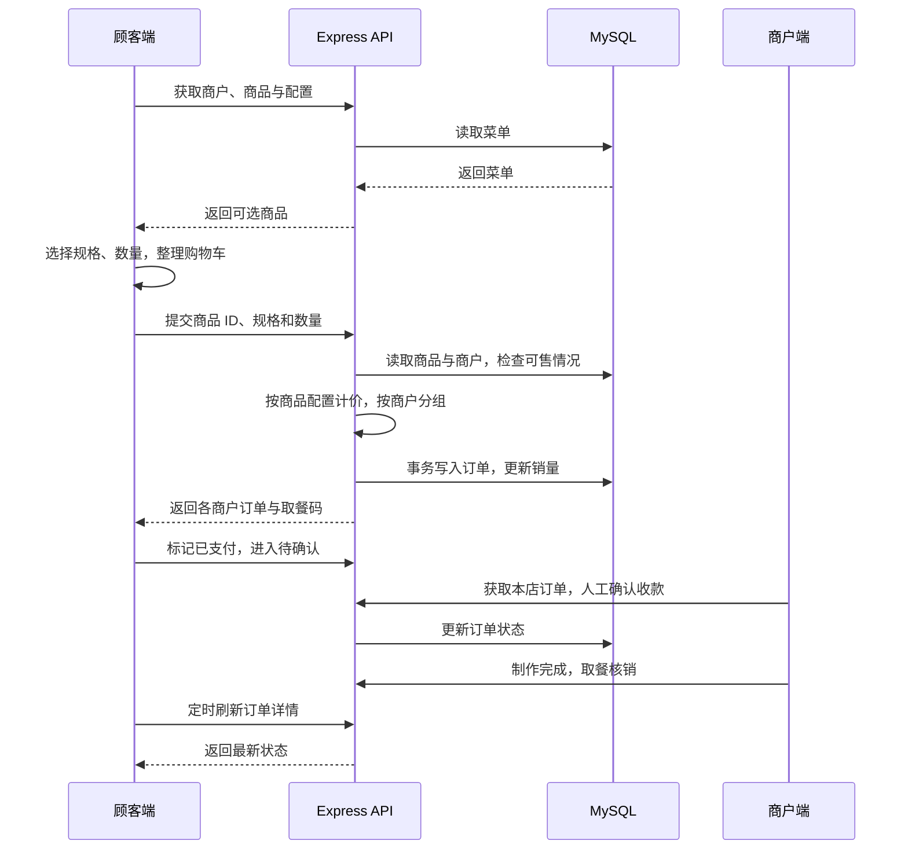
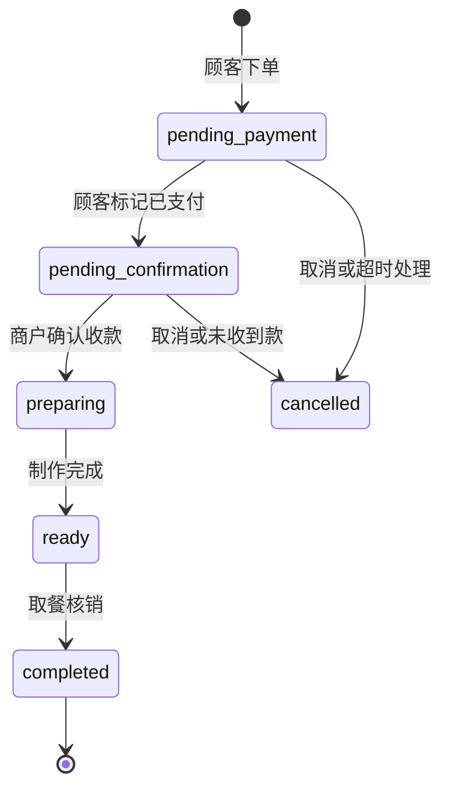

# 架构与实现

滩摊由三个独立 React 应用和一个共享 API 组成。前端负责各角色的交互，API 负责数据访问和业务计算，MySQL 保存商户、商品、订单和平台设置。

## 应用边界

| 目录 | 职责 | 入口与关键文件 |
| --- | --- | --- |
| `c-app` | 顾客浏览、菜单选择、购物车、结算与订单 | `App.tsx`、`components/CheckoutView.tsx`、`components/OrderDetailView.tsx` |
| `b-app` | 商户登录、商品维护、订单处理与店铺设置 | `App.tsx`、`components/OrderManager.tsx`、`components/ProductManager.tsx` |
| `admin-app` | 商户管理、经营总览、平台配置 | `src/App.tsx`、`src/components/VendorManager.tsx`、`src/components/ConfigPanel.tsx` |
| `api` | HTTP 接口、权限边界、计价与持久化 | `server/index.ts`、`server/db.ts`、`utils/specs.ts` |

开发时，Vite 将各端的 `/api` 请求代理至 `localhost:8787`。部署时需要为前端静态资源和 API 配置自己的访问入口；Vite 开发代理不是生产网关。

## 下单数据流

前端传入选择结果，商品基础价格来自数据库；规格加价通过商品配置计算。一次购物车提交可能生成多张商户订单，订单明细保存下单时的名称、金额与图片等快照。

库存和销量已有基本校验与更新，但并发库存检查不等同于高并发防超卖方案。

## 订单状态

下面是当前自提演示的主要路径，不代表所有服务端状态迁移都已被严格限制：

对应代码状态为 `pending-payment`、`pending-confirmation`、`preparing`、`ready`、`completed`、`cancelled`。模型还保留 `delivering`，但顾客端暂未开放海滩配送下单。

支付状态与订单状态分别记录。界面中的微信 / 支付宝指商户的线下收款方式；API 中的 `payment-callback` 是受管理员权限保护的状态更新接口，不能当作已接入支付平台的验签回调。

## 数据与身份

| 数据表 | 保存内容 |
| --- | --- |
| `vendors` | 摊位码、店铺资料、营业设置、登录密码哈希等 |
| `products` | 商品、分类、规格选项、价格、售罄状态与销量 |
| `orders` | 订单快照、顾客标识、取餐码、状态、支付凭证等 |
| `admins` | 管理员账号与密码哈希 |
| `settings` | 平台配置、默认地址与配送意愿计数等 |

API 启动时执行建库、建表及空表种子初始化。种子定义在 `api/data.ts`，不依赖数据库导出文件。

- 管理员与商户通过登录接口取得带过期时间的签名令牌；商户请求在服务端按所属商户过滤和校验。
- 密码使用 scrypt 哈希存储。浏览器端保存登录令牌，本地演示账号见根目录 README。
- 顾客端使用 localStorage 生成并保存匿名标识，通过 `X-Buyer-Id` 关联订单。这不是经过验证的消费者账号，清除浏览器数据后不会自动恢复旧标识。
- 收藏与最近访问保存在浏览器中；商品、订单和平台配置保存在 MySQL。

## 可选集成

**Gemini：** `server/ai-service.ts` 从当前商户和商品数据构造推荐上下文；密钥只放在 API 环境变量中。首页使用每日海岛提示接口。完整顾问组件还未接入主导航；未配置密钥时返回空内容。

**对象存储：** `server/oss.ts` 通过 S3 兼容接口上传图片并保存公共图片 URL。当前环境变量沿用 `RAINYUN_*` 命名。已有远程图片可直接展示，上传本地图片和付款凭证需要配置存储。

**二维码：** 服务端生成进店二维码，顾客端展示订单取餐二维码；商户端提供扫描与人工核销操作。摄像头功能还取决于浏览器权限和安全上下文。

## 后续可以完善的地方

- 将各端重复的领域类型和计算逻辑收敛到共享包。
- 引入明确的数据库迁移版本和可重复的独立种子脚本。
- 完善消费者身份验证、订单状态机、库存并发与操作审计。
- 将评价、地址、优惠券等原型接入完整的数据与业务校验。
- 将运行时 Tailwind 依赖转为构建时样式生成，完善静态资源管理。

功能是否已接通，以根目录 README 的[功能边界](../README.md#功能边界)为准。
